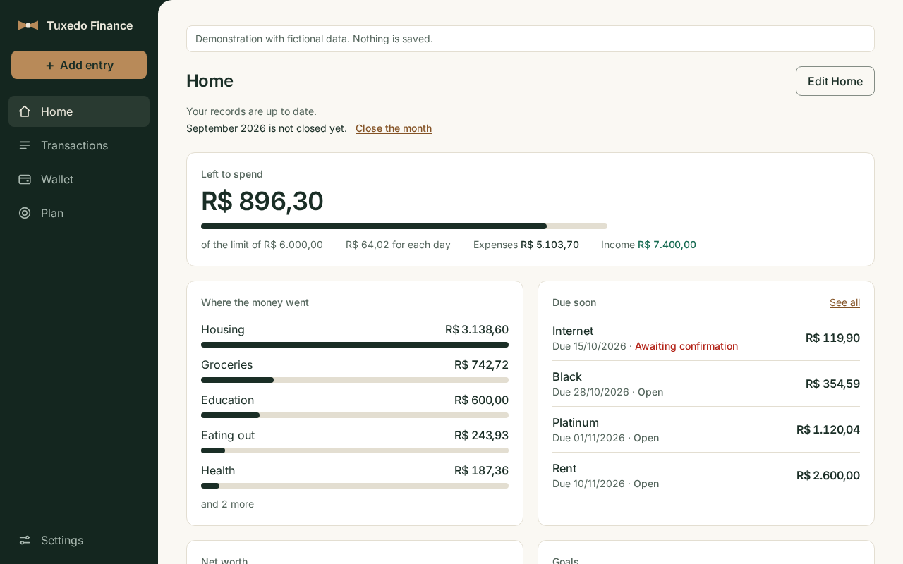

# Tuxedo Finance

A self-hosted personal finance application for one person who enters data by
hand. No bank connection. An entry takes a few seconds, and Home answers the
questions of the month: how much is left, where the money went, what is due.

[Português](README.pt-BR.md)



| Plan | A window |
|---|---|
|  |  |

The images show the demonstration data of the [public page](site/README.md).

## What it does

- **Entries** in a few seconds, with installments and repeating entries. A
  bank statement (OFX or CSV) can be imported and reviewed row by row.
- **Wallet**: accounts, cards and invoices, transfers, investments, points
  and miles, and accounts in other currencies.
- **Home**: blocks that you choose. Left to spend, where the money went, what
  is due, net worth, goals.
- **Plan**: a limit for the month, budgets by category, goals that reserve
  real balances, the months ahead with a sheet to try changes, and a short
  closing of each month.
- Every object opens in a window above the page, and the page keeps its
  place.
- English and Brazilian Portuguese.

## State

Version 2.0 is a new application on the 1.x financial rules: a Django API
and a React client. It is not released yet. It has a new database, and there
is no upgrade from 1.x. The last 1.x release is the tag
[`v1.0.0`](https://github.com/HenriqueMayer/TuxedoFinance/tree/v1.0.0).

## Run it

Requirements: Python 3.12 with [uv](https://docs.astral.sh/uv/) and Node.js 22.

```bash
cd web && npm ci && npx vite build
cd ../backend && cp .env.example .env    # set SECRET_KEY in .env
uv sync
uv run python manage.py migrate
uv run python manage.py createsuperuser
uv run python manage.py runserver
```

Open http://127.0.0.1:8000.

With Docker: see [Operations](docs/operations.md#docker).

## Documentation

[Product](docs/product.md) · [Architecture](docs/architecture.md) ·
[Data model](docs/data-model.md) · [Development](docs/development.md) ·
[Operations](docs/operations.md)

## License

[PolyForm Noncommercial 1.0.0](LICENSE).
