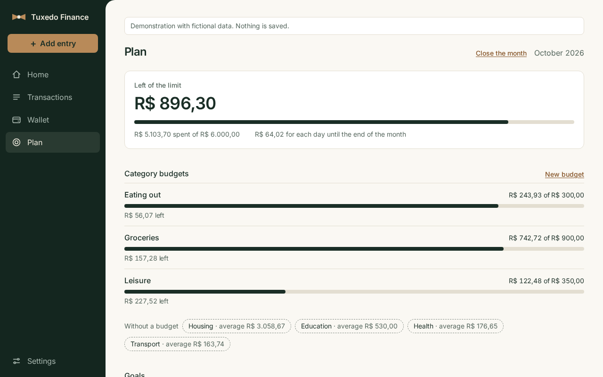
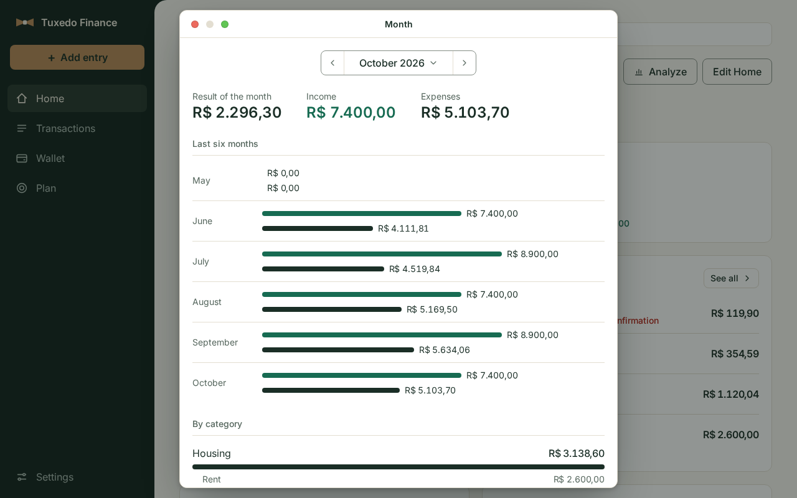
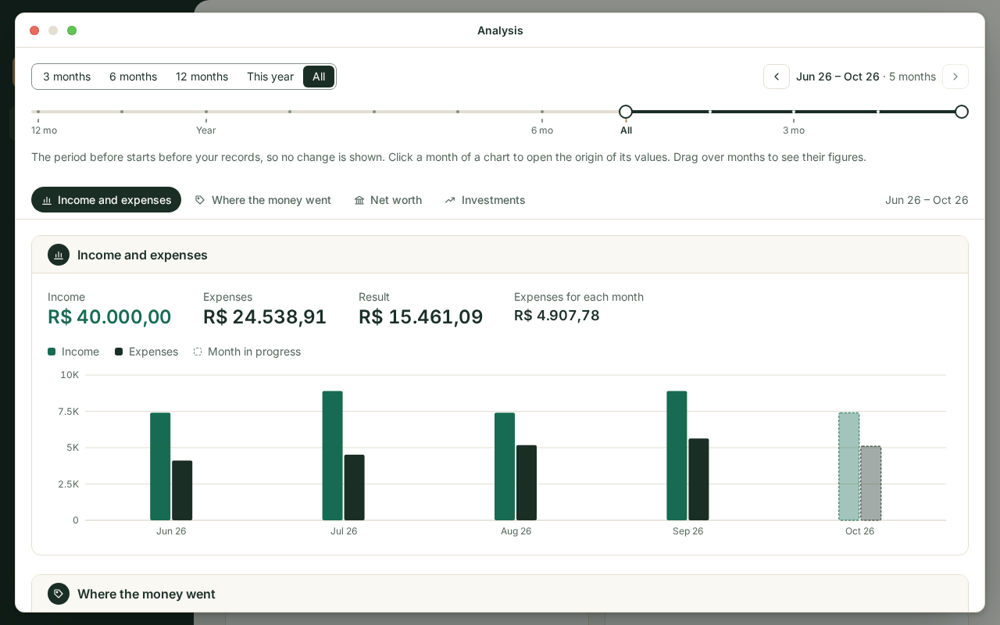
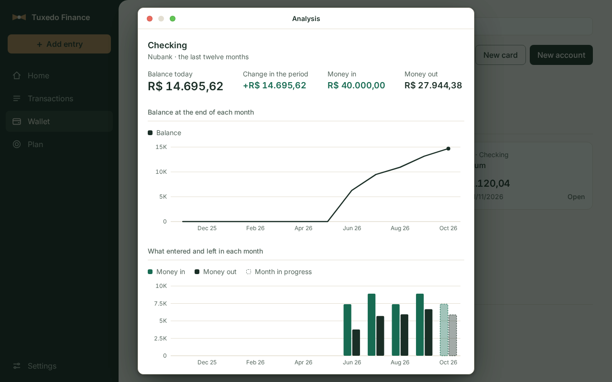

[English](README.md) · [Português (Brasil)](README.pt-BR.md) · **[Live preview ↗](https://henriquemayer.github.io/TuxedoFinance/)**

<h1></h1>

<p align="center">
  <b>Personal finance that you run yourself.</b><br>
  You type what happened, in a few seconds, and Home answers the questions of the month:<br>
  how much is left, where the money went and what is due.
</p>

<p align="center">
  <a href="https://henriquemayer.github.io/TuxedoFinance/"></a>
</p>

<p align="center">
  <sub>The preview is the application itself, in your browser, with the records of a fictional owner.<br>
  Nothing to install. Nothing is saved.</sub>
</p>

<p align="center">
  <a href="https://github.com/HenriqueMayer/TuxedoFinance/actions/workflows/backend.yml"></a>
  <a href="https://github.com/HenriqueMayer/TuxedoFinance/actions/workflows/web.yml"></a>
  <a href="https://github.com/HenriqueMayer/TuxedoFinance/actions/workflows/pages.yml"></a>
  <a href="LICENSE"></a>
</p>

<p align="center">
  <a href="#whats-in-the-app">What's in the app</a> ·
  <a href="#analysis">Analysis</a> ·
  <a href="#quick-start">Quick start</a> ·
  <a href="docs/README.md">Documentation</a> ·
  <a href="CHANGELOG.md">Changes</a>
</p>

<p align="center">
  <sub>Every image on this page comes from the preview. Click the image to open it.</sub>
</p>

| Your records stay with you | An entry takes seconds | Each screen answers a question |
|---|---|---|
| One SQLite file on the computer that runs the application. No bank connection, no account with anyone. | A title, an amount and a date. Installments, a monthly repetition or a bank statement (OFX or CSV) when you need them. | Four destinations. Every object opens in a window above the page, and the page keeps its place. |

## What's in the app

Four destinations, one question each.

| Destination | Answers | What you do there |
|---|---|---|
| **Home** | How is this month? | Read what is left to spend, where the money went, what is due, your net worth and your goals. You choose the blocks and their order. |
| **Transactions** | What did I record? | Add an entry in a few seconds, with installments or a monthly repetition. Import a bank statement (OFX or CSV) and review it row by row. |
| **Wallet** | What do I have and what do I owe? | Keep accounts, credit and debit cards, invoices, transfers, investments, points and miles, and accounts in other currencies. |
| **Plan** | What do I intend? | Set a limit for the month and budgets by category, reserve real balances for goals, look at the months ahead, and close each month. |

| Plan | A window |
|---|---|
|  |  |

The interface is in English and Brazilian Portuguese, with a light and a dark
theme, on a desktop and on a phone. Settings has the base currency, the order
of a date and the way a number is written (`1.234,56` or `1,234.56`).

## Analysis

**Analyze**, on Home, opens a period of up to 60 months in four areas: income
and expenses, where the money went, net worth, and investments. Each figure
is compared with the period before. A click on a month opens the origin of
its values, and a drag over months gives their figures.

In the Wallet, an account, a card and an investment each have an analysis of
the last twelve months, with the item beside every item of its kind.

| A period | One account |
|---|---|
|  |  |

## Quick start

**From the source.** Requirements: Python 3.12 with
[uv](https://docs.astral.sh/uv/) and Node.js 22.

```bash
git clone https://github.com/HenriqueMayer/TuxedoFinance.git
cd TuxedoFinance/web && npm ci && npx vite build
cd ../backend && cp .env.example .env    # set SECRET_KEY in .env
uv sync
uv run python manage.py migrate
uv run python manage.py runserver
```

**With Docker.**

```bash
git clone https://github.com/HenriqueMayer/TuxedoFinance.git
cd TuxedoFinance
docker build -t tuxedo-finance:local .
cp .env.docker.example .env              # set TUXEDO_IMAGE and SECRET_KEY
docker compose up -d
```

Open http://127.0.0.1:8000 and create your account. The settings of an
installation are in [Operations](docs/operations.md).

## Your data

All records are in one SQLite file on the computer that runs the
application. Backup and restore are two commands: see
[Operations](docs/operations.md#data).

## Documentation

| Subject | File |
|---|---|
| What the product is and what each area does | [Product](docs/product.md) |
| Repository layout, the API, the client and the tests | [Architecture](docs/architecture.md) |
| Records and financial rules | [Data model](docs/data-model.md) |
| Setup, commands and checks | [Development](docs/development.md) |
| Settings, data, Docker and a release | [Operations](docs/operations.md) |
| The public page and its demonstration | [Site](site/README.md) |
| How to propose a change | [Contributing](CONTRIBUTING.md) |

## State

Version 2.0 is a new application on the 1.x financial rules: a Django API
and a React client. It is not released yet. It has a new database, and there
is no upgrade from 1.x. The last 1.x release is the tag
[`v1.0.2`](https://github.com/HenriqueMayer/TuxedoFinance/tree/v1.0.2).

## License

[PolyForm Noncommercial 1.0.0](LICENSE): free for personal, noncommercial use.
