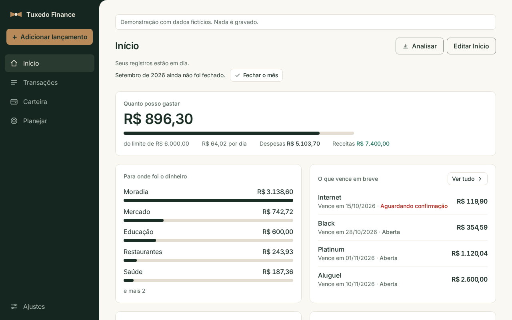

[English](README.md) · [Português (Brasil)](README.pt-BR.md)

<h1></h1>

Finanças pessoais que rodam no seu computador. Você lança o que aconteceu, em
poucos segundos, e o Início responde às perguntas do mês: quanto resta, para
onde foi o dinheiro e o que vence. Sem conexão com banco e sem conta em
serviço nenhum: seus registros ficam na sua instalação.

<p align="center">
  <a href="https://henriquemayer.github.io/TuxedoFinance/pt-br/"></a>
</p>

<p>
  <a href="https://github.com/HenriqueMayer/TuxedoFinance/actions/workflows/backend.yml"></a>
  <a href="https://github.com/HenriqueMayer/TuxedoFinance/actions/workflows/web.yml"></a>
  <a href="LICENSE"></a>
</p>

[Como rodar](#como-rodar) · [O que tem no app](#o-que-tem-no-app) · [Documentação](docs/README.md) · [Mudanças](CHANGELOG.md)

<a href="https://henriquemayer.github.io/TuxedoFinance/pt-br/"></a>

A prévia é o próprio aplicativo, rodando no seu navegador com os registros de
um dono fictício. As imagens desta página vêm dela.

## O que tem no app

Quatro destinos, uma pergunta para cada. Cada objeto abre em uma janela sobre
a página, e a página mantém a posição.

| Destino | Responde | O que você faz ali |
|---|---|---|
| **Início** | Como está este mês? | Lê quanto resta para gastar, para onde foi o dinheiro, o que vence, seu patrimônio e suas metas. Você escolhe os blocos e a ordem. |
| **Transações** | O que eu registrei? | Lança em poucos segundos, com parcelas ou repetição mensal. Importa um extrato do banco (OFX ou CSV) e revisa linha a linha. |
| **Carteira** | O que eu tenho e o que eu devo? | Mantém contas, cartões e faturas, transferências, investimentos, pontos e milhas, e contas em outras moedas. |
| **Planejar** | O que eu pretendo? | Define um limite para o mês e orçamentos por categoria, reserva saldos reais para metas, olha os próximos meses e fecha cada mês. |

| Planejar | Uma janela |
|---|---|
|  |  |

Português do Brasil e inglês, tema claro e escuro, computador e celular.

## Como rodar

Requisitos: Python 3.12 com [uv](https://docs.astral.sh/uv/) e Node.js 22.

```bash
git clone https://github.com/HenriqueMayer/TuxedoFinance.git
cd TuxedoFinance/web && npm ci && npx vite build
cd ../backend && cp .env.example .env    # defina SECRET_KEY no .env
uv sync
uv run python manage.py migrate
uv run python manage.py createsuperuser
uv run python manage.py runserver
```

Abra http://127.0.0.1:8000.

Com Docker: veja [Operations](docs/operations.md#docker).

## Seus dados

Todos os registros ficam em um arquivo SQLite no computador que roda a
aplicação. Cópia e restauração são dois comandos: veja
[Operations](docs/operations.md#data).

## Documentação

A documentação técnica está em inglês.

| Assunto | Arquivo |
|---|---|
| O que é o produto e o que cada área faz | [Product](docs/product.md) |
| Estrutura do repositório, a API, o cliente e os testes | [Architecture](docs/architecture.md) |
| Registros e regras financeiras | [Data model](docs/data-model.md) |
| Preparação, comandos e checagens | [Development](docs/development.md) |
| Configurações, dados, Docker e lançamento de versão | [Operations](docs/operations.md) |
| A página pública e a demonstração | [Site](site/README.md) |

## Estado

A versão 2.0 é uma aplicação nova sobre as regras financeiras da 1.x: uma
API Django e um cliente React. Ainda não foi lançada. Ela tem um banco de
dados novo, e não há atualização a partir da 1.x. A última versão 1.x é a
tag [`v1.0.0`](https://github.com/HenriqueMayer/TuxedoFinance/tree/v1.0.0).

## Licença

[PolyForm Noncommercial 1.0.0](LICENSE): gratuito para uso pessoal e não
comercial.
