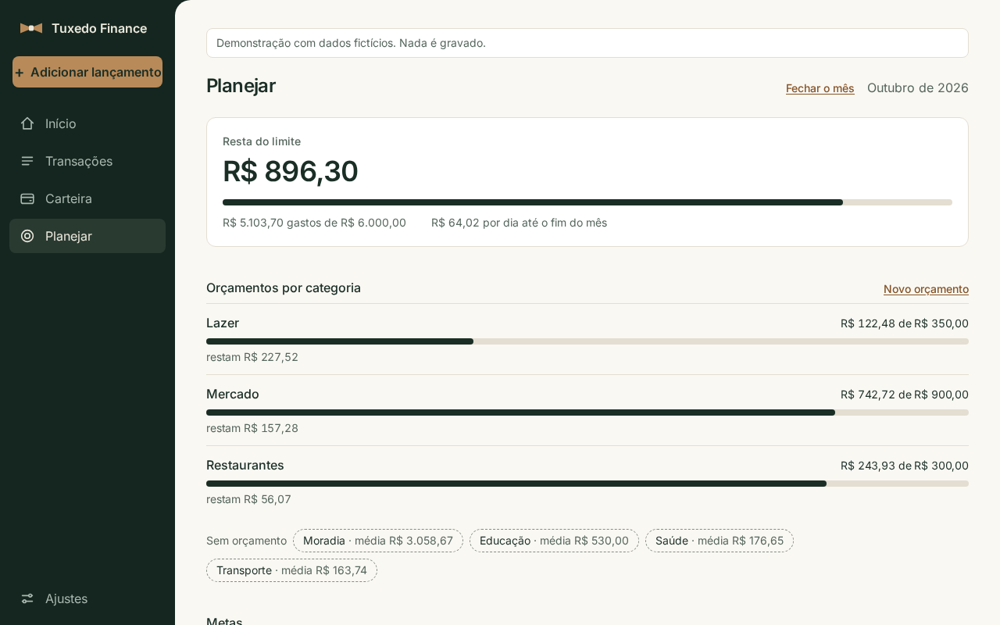
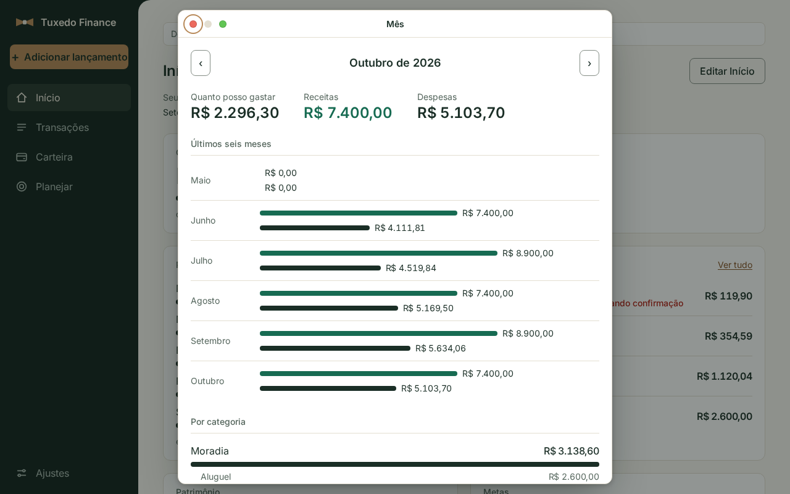
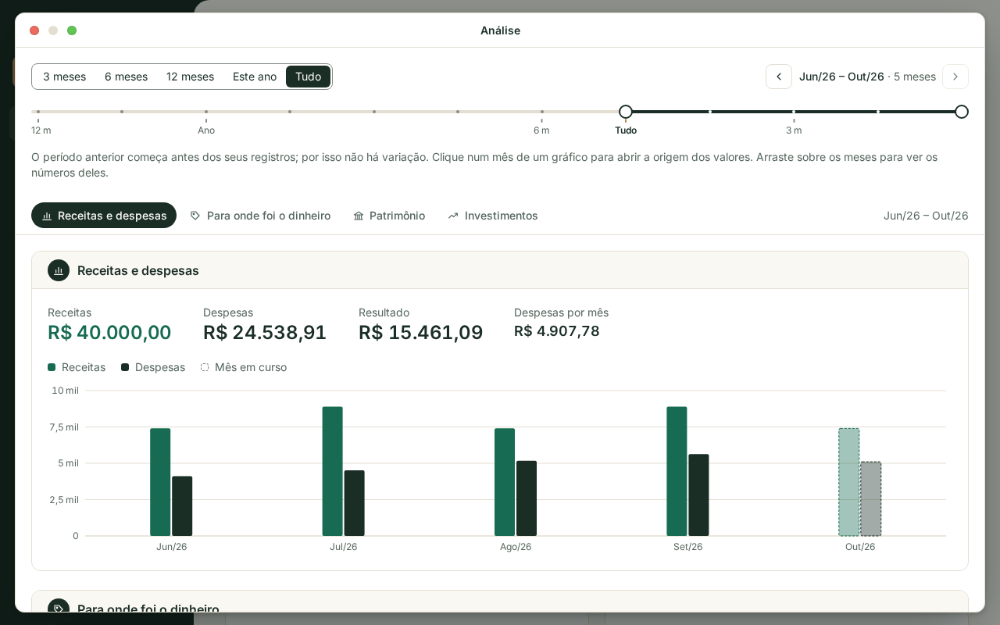
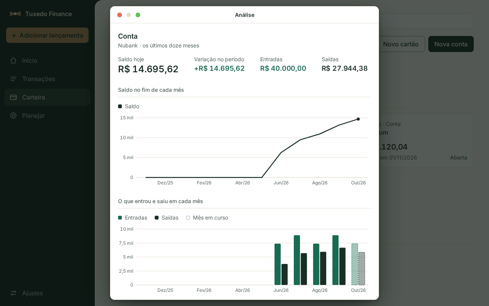

[English](README.md) · [Português (Brasil)](README.pt-BR.md) · **[Prévia ao vivo ↗](https://henriquemayer.github.io/TuxedoFinance/pt-br/)**

<h1></h1>

<p align="center">
  <b>Finanças pessoais que rodam no seu computador.</b><br>
  Você lança o que aconteceu, em poucos segundos, e o Início responde às perguntas do mês:<br>
  quanto resta, para onde foi o dinheiro e o que vence.
</p>

<p align="center">
  <a href="https://henriquemayer.github.io/TuxedoFinance/pt-br/"></a>
</p>

<p align="center">
  <sub>A prévia é o próprio aplicativo, no seu navegador, com os registros de um dono fictício.<br>
  Nada para instalar. Nada é salvo.</sub>
</p>

<p align="center">
  <a href="https://github.com/HenriqueMayer/TuxedoFinance/actions/workflows/ci.yml"></a>
  <a href="https://github.com/HenriqueMayer/TuxedoFinance/actions/workflows/pages.yml"></a>
  <a href="LICENSE"></a>
</p>

<p align="center">
  <a href="#o-que-tem-no-app">O que tem no app</a> ·
  <a href="#análise">Análise</a> ·
  <a href="#como-rodar">Como rodar</a> ·
  <a href="docs/README.md">Documentação</a> ·
  <a href="CHANGELOG.md">Mudanças</a>
</p>

<p align="center">
  <sub>Todas as imagens desta página vêm da prévia. Clique na imagem para abri-la.</sub>
</p>

| Seus registros ficam com você | Um lançamento leva segundos | Cada tela responde a uma pergunta |
|---|---|---|
| Um arquivo SQLite no computador que roda a aplicação. Sem conexão com banco e sem conta em serviço nenhum. | Um título, um valor e uma data. Parcelas, repetição mensal ou extrato do banco (OFX ou CSV) quando você precisa. | Quatro destinos. Cada objeto abre em uma janela sobre a página, e a página mantém a posição. |

## O que tem no app

Quatro destinos, uma pergunta para cada.

| Destino | Responde | O que você faz ali |
|---|---|---|
| **Início** | Como está este mês? | Lê quanto resta para gastar, para onde foi o dinheiro, o que vence, seu patrimônio e suas metas. Você escolhe os blocos e a ordem. |
| **Transações** | O que eu registrei? | Lança em poucos segundos, com parcelas ou repetição mensal. Importa um extrato do banco (OFX ou CSV) e revisa linha a linha. |
| **Carteira** | O que eu tenho e o que eu devo? | Mantém contas, cartões de crédito e de débito, faturas, transferências, investimentos, pontos e milhas, e contas em outras moedas. |
| **Planejar** | O que eu pretendo? | Define um limite para o mês e orçamentos por categoria, reserva saldos reais para metas, olha os próximos meses e fecha cada mês. |

| Planejar | Uma janela |
|---|---|
|  |  |

A interface está em português do Brasil e em inglês, com tema claro e
escuro, no computador e no celular. Em Ajustes ficam a moeda base, a ordem da
data e a forma de escrever um número (`1.234,56` ou `1,234.56`).

## Análise

**Analisar**, no Início, abre um período de até 60 meses em quatro áreas:
receitas e despesas, para onde foi o dinheiro, patrimônio e investimentos.
Cada valor é comparado com o período anterior. Um clique em um mês abre a
origem dos valores, e arrastar sobre os meses mostra os valores deles.

Na Carteira, uma conta, um cartão e um investimento têm cada um uma análise
dos últimos doze meses, com o item ao lado de todos os itens do mesmo tipo.

| Um período | Uma conta |
|---|---|
|  |  |

## Como rodar

**A partir do código.** Requisitos: Python 3.12 com
[uv](https://docs.astral.sh/uv/) e Node.js 22.

```bash
git clone https://github.com/HenriqueMayer/TuxedoFinance.git
cd TuxedoFinance/web && npm ci && npx vite build
cd ../backend && cp .env.example .env    # defina SECRET_KEY no .env
uv sync
uv run python manage.py migrate
uv run python manage.py runserver
```

**Com Docker.**

```bash
git clone https://github.com/HenriqueMayer/TuxedoFinance.git
cd TuxedoFinance
docker build -t tuxedo-finance:local .
cp .env.docker.example .env              # defina TUXEDO_IMAGE e SECRET_KEY
docker compose up -d
```

Abra http://127.0.0.1:8000 e crie a sua conta. As configurações de uma
instalação estão em [Operations](docs/operations.md).

## Seus dados

Todos os registros ficam em um arquivo SQLite no computador que roda a
aplicação. Cópia e restauração são dois comandos: veja
[Operations](docs/operations.md#data).

## Documentação

A documentação técnica está em inglês.

| Assunto | Arquivo |
|---|---|
| O que é o produto e o que cada área faz | [Product](docs/product.md) |
| Estrutura do repositório, a API, o cliente e os testes | [Architecture](docs/architecture.md) |
| Registros e regras financeiras | [Data model](docs/data-model.md) |
| Preparação, comandos e checagens | [Development](docs/development.md) |
| Configurações, dados, Docker e lançamento de versão | [Operations](docs/operations.md) |
| A página pública e a demonstração | [Site](site/README.md) |
| Como propor uma mudança | [Contributing](CONTRIBUTING.md) |

## Estado

A versão 2.0 é uma aplicação nova sobre as regras financeiras da 1.x: uma
API Django e um cliente React. Ela tem um banco de dados novo, e não há
atualização a partir da 1.x. A última versão 1.x é a tag
[`v1.0.2`](https://github.com/HenriqueMayer/TuxedoFinance/tree/v1.0.2).

## Licença

[PolyForm Noncommercial 1.0.0](LICENSE): gratuito para uso pessoal e não
comercial.
