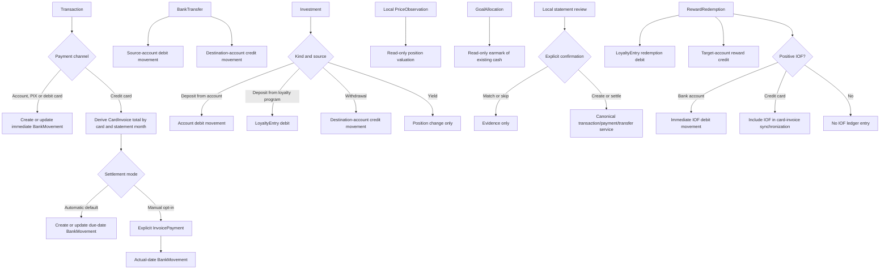

# Data Model

The current schema and business rules cover `0.10.0` plus implemented Unreleased
changes. Supported releases preserve their financial rows through incremental
migrations. Only unsupported pre-release legacy schemas lack automatic
conversion; see [Breaking release](#breaking-release).

Schema presence does not imply an available interface. Statement operations and
the dated net-worth screen are currently paused; their stored provenance and
underlying financial calculations are preserved. See the [roadmap](roadmap.md)
and owning app guide for the active route contract.

## Entity-relationship diagram

```mermaid
erDiagram
    USER ||--|| USER_PREFERENCE : configures
    USER ||--o{ BANK : owns
    USER ||--o{ CATEGORY : owns
    USER ||--o{ TRANSACTION : records
    USER ||--o{ BANK_TRANSFER : records
    USER ||--o{ EXCHANGE_RATE : records
    USER ||--o{ LOYALTY_PROGRAM : owns
    USER ||--o{ REWARD_REDEMPTION : records
    USER ||--o{ INVESTMENT_PRODUCT : owns
    USER ||--o{ ASSET : owns
    USER ||--o{ INVESTMENT : records
    USER ||--o{ PRICE_OBSERVATION : records
    USER ||--o{ INVOICE_PAYMENT : confirms
    USER ||--o{ CATEGORY_BUDGET : configures
    USER ||--o{ FINANCIAL_GOAL : owns
    USER ||--o{ GOAL_ALLOCATION : reserves
    USER ||--o| SIGNAL_SETTINGS : configures
    USER ||--o{ SIGNAL_DECISION : reviews
    USER ||--o{ IMPORT_BATCH : reviews
    USER ||--o{ CONVERSATION : owns
    CONVERSATION ||--o{ MESSAGE : contains
    USER ||--o{ PROVIDER_CONNECTION : owns
    USER ||--o{ AUTHORIZATION_ATTEMPT : authorizes
    PROVIDER_CONNECTION |o--o{ AUTHORIZATION_ATTEMPT : links
    CONVERSATION ||--o{ GENERATION_RUN : records
    PROVIDER_CONNECTION |o--o{ GENERATION_RUN : authorizes

    BANK ||--o{ BANK_ACCOUNT : contains
    BANK_ACCOUNT ||--o{ BANK_MOVEMENT : posts
    BANK_ACCOUNT ||--o{ DEBIT_CARD : issues
    BANK_ACCOUNT ||--o{ CREDIT_CARD : issues
    BANK_ACCOUNT ||--o{ BANK_TRANSFER : sends
    BANK_ACCOUNT ||--o{ BANK_TRANSFER : receives
    CREDIT_CARD ||--o{ CARD_INVOICE : generates
    CARD_INVOICE |o--o| BANK_MOVEMENT : settles_as
    CARD_INVOICE ||--o{ INVOICE_PAYMENT : receives
    BANK_ACCOUNT ||--o{ INVOICE_PAYMENT : funds
    INVOICE_PAYMENT |o--o| BANK_MOVEMENT : confirms_actual_debit
    BANK_TRANSFER ||--|{ BANK_MOVEMENT : posts_two
    EXCHANGE_RATE |o--o{ BANK_TRANSFER : evidences

    CATEGORY |o--o{ CATEGORY : parent_of
    CATEGORY ||--o{ TRANSACTION : classifies
    TRANSACTION ||--o{ TRANSACTION_SPLIT : allocates
    CATEGORY ||--o{ TRANSACTION_SPLIT : classifies_share
    CATEGORY ||--o{ CATEGORY_BUDGET : limits
    BANK_ACCOUNT |o--o{ TRANSACTION : account_or_pix
    DEBIT_CARD |o--o{ TRANSACTION : debit_channel
    CREDIT_CARD |o--o{ TRANSACTION : credit_channel

    BANK |o--o{ LOYALTY_PROGRAM : offers
    CREDIT_CARD }o--o{ LOYALTY_PROGRAM : participates_in
    LOYALTY_PROGRAM ||--o{ LOYALTY_ENTRY : records
    CARD_INVOICE |o--o{ LOYALTY_ENTRY : awards
    BANK_ACCOUNT |o--o{ LOYALTY_ENTRY : funds_purchase
    CREDIT_CARD |o--o{ LOYALTY_ENTRY : funds_purchase
    LOYALTY_ENTRY |o--o| BANK_MOVEMENT : posts_purchase_debit
    LOYALTY_PROGRAM ||--o{ REWARD_REDEMPTION : redeems
    REWARD_REDEMPTION |o--o| LOYALTY_ENTRY : posts_points_debit
    REWARD_REDEMPTION |o--o| BANK_MOVEMENT : posts_reward_credit
    REWARD_REDEMPTION |o--o| BANK_MOVEMENT : posts_iof_debit
    REWARD_REDEMPTION |o--o| TRANSACTION : derives_iof_expense
    BANK_ACCOUNT ||--o{ REWARD_REDEMPTION : receives_reward
    BANK_ACCOUNT |o--o{ REWARD_REDEMPTION : funds_iof
    CREDIT_CARD |o--o{ REWARD_REDEMPTION : funds_iof

    BANK ||--o{ INVESTMENT_PRODUCT : provides
    INVESTMENT_PRODUCT |o--o{ ASSET : holds_opening_position
    INVESTMENT_PRODUCT ||--o{ INVESTMENT : records
    ASSET ||--o{ INVESTMENT : denominates
    ASSET ||--o{ PRICE_OBSERVATION : priced_at
    BANK_ACCOUNT |o--o{ INVESTMENT : funds_or_receives
    LOYALTY_PROGRAM |o--o{ INVESTMENT : funds_with_points
    EXCHANGE_RATE |o--o{ INVESTMENT : evidences
    INVESTMENT |o--o| BANK_MOVEMENT : posts_cash_leg
    INVESTMENT |o--o| LOYALTY_ENTRY : posts_points_leg

    FINANCIAL_GOAL ||--o{ GOAL_ALLOCATION : names_reserve
    BANK_ACCOUNT |o--o{ GOAL_ALLOCATION : earmarked_account
    INVESTMENT_PRODUCT |o--o{ GOAL_ALLOCATION : earmarked_cash_product
    ASSET |o--o{ GOAL_ALLOCATION : earmarked_monetary_asset
    BANK_ACCOUNT ||--o{ IMPORT_BATCH : reviewed_statement
    IMPORT_BATCH ||--o{ IMPORTED_ROW : contains
    IMPORTED_ROW ||--o| EXTERNAL_STATEMENT_IDENTITY : establishes
    BANK_ACCOUNT ||--o{ EXTERNAL_STATEMENT_IDENTITY : scopes_identifier
    IMPORTED_ROW }o--o| TRANSACTION : creates_source
    IMPORTED_ROW }o--o| INVOICE_PAYMENT : creates_payment
    IMPORTED_ROW }o--o| BANK_TRANSFER : creates_transfer
    IMPORTED_ROW }o--o| BANK_MOVEMENT : matches_existing
```

Financial ownership is direct or inherited through an owned source: for example,
`TransactionSplit` inherits its transaction owner and `ImportedRow` its batch
owner. Optional edges reflect nullable
foreign keys. Business services enforce stronger rules where the database shape
alone cannot—for example, a transfer posts exactly two movements and a
transaction selects exactly one payment instrument.

`Transaction` does not have a foreign key to `CardInvoice` or `BankMovement`.
The idempotent ledger synchronization service derives immediate movements and
card-invoice totals from the transaction's channel, instrument, date and
recurrence fields. It also pre-creates future-effective rows; realized cash
queries include only movements effective through the requested date. The generated movement's `source_key` preserves that source
identity without creating a model relationship.

## Posting and data flow

The service layer posts each workflow atomically and synchronizes derived rows
idempotently. `BankMovement` remains the source of realized account cash;
transactions, invoices, investment positions and loyalty points retain their
separate economic meaning.

## Banking

### `UserPreference`

`UserPreference` belongs to the native Django user through a one-to-one
relationship and stores `base_currency`, chosen from the supported currency
registry, plus the user's `date_format` presentation preference. The row is
created on signup and a data migration safely creates it
for existing users with the BRL bootstrap default. It is a presentation
preference: changing it never rewrites native account, transaction, investment,
or exchange-rate data.

Public registration does not add a profile or registration model. The
`ALLOW_SIGNUPS` environment setting controls whether the native Django `User`
creation route is open; disabling it leaves existing user rows and login
behavior untouched.

### `Bank`

| Field | Meaning |
|---|---|
| `user` | Owner; all names and relationships are user-scoped. |
| `name` | Bank, broker, exchange, or other financial provider. |
| `color` | Optional validated `#RRGGBB` identity marker; no financial meaning. |
| timestamps | `created_at`, `updated_at`. |

`Bank` is the shared provider entity used by banking, loyalty, and investments.
The former investment-only `Institution` model is removed.

### `BankAccount`

| Field | Meaning |
|---|---|
| `bank` | Owning `Bank`. |
| `name` | User-facing account label. |
| `currency` | Native ISO 4217 currency; immutable after the first movement. |
| `opening_balance` | Native tracked starting balance; no synthetic movement. |
| `opening_date` | Nullable baseline date; required for new nonzero openings. |
| `planning_enabled` / `reserved_amount` | Inclusion and manual native reserve, without changing ledger cash. |
| `pix_enabled` | Account capability, `True` by default. |
| timestamps | `created_at`, `updated_at`. |

A bank has many accounts; currency does not identify an account. Multiple BRL,
USD, or other accounts under the same bank are valid.
The opening applies only on and after a known baseline date. Existing null
dates remain unknown through migration and make dated wealth incomplete.
Forms reject an opening date after an existing movement; import confirmation
requires a known date for a nonzero opening rather than inferring one.
Any saved goal allocation also blocks account-currency changes, including
archived goals, preserving the reservation's native denomination.

### `BankMovement`

| Field | Meaning |
|---|---|
| `account` | Ledger being changed. |
| `amount` | Positive amount in the account's currency. |
| `direction` | `CREDIT` or `DEBIT`; determines the sign. |
| `kind` | `INCOME`, `EXPENSE`, `TRANSFER`, `INVOICE`, `INVESTMENT`, `REWARD`, or `ADJUSTMENT`. |
| `effective_date` | Settlement date used for balance calculation. |
| `description` | Optional user-facing movement description. |
| `invoice` | Optional one-to-one invoice settlement link. |
| `transfer` | Optional link to the two-sided `BankTransfer`. |
| `source_key` | Optional per-user idempotency key for a source-backed movement. |

`available_balance = applicable opening_balance + credits - debits`. This ledger is the
only source of account balance. Source-backed rows are synchronized when their
transaction, invoice, transfer, investment, or reward source changes.

### Cards and invoices

`DebitCard` and `CreditCard` both belong to one owned account and have a name.
Both also store `color`, optional `gradient_end` and `gradient_angle` (0–359)
for their shared miniatures. These presentation fields are independent of the
bank's marker and do not alter currency, settlement or balances.
`CreditCard` additionally stores `card_type`, `closing_day`, `due_day` and
`manual_settlement_from`. A `CardInvoice` belongs to a credit card and records reference month,
due date, amount, status, paid timestamp and sticky manual-settlement flag.

A debit purchase creates a transaction and immediate debit movement. A credit
purchase has no direct invoice foreign key: synchronization groups it by card
and statement month into a `CardInvoice`, with no purchase-date account debit.
By default the invoice has one due-date `INVOICE` movement for its payable total. Dashboard
logic must never add invoice purchases to account balance separately from that
movement.

`manual_settlement_from` defaults to null and uses invoice due dates as the
opt-in boundary. A manual invoice has no synthetic due-date movement. Its
`InvoicePayment(user, invoice, account, amount, date, notes, confirmation_key,
movement)` rows each own an actual-date debit. Invoice and account references
use `PROTECT`, and ownership/currency/positive amount/date checks are enforced
before posting. The UUID is unique; identical retries return the prior payment,
and conflicting reuse is rejected.

Manual statuses are `SCHEDULED`, `PARTIAL`, `OVERDUE` or `PAID` based on payments
through the cutoff. A payment cannot exceed the current total less other
payments when saved. Later purchase corrections retain real payments and may
produce card credit. Historical debt uses dated payment evidence, not today's
status. See [manual settlement](apps/banking.md#optional-manual-settlement).

## Transactions

| Field | Meaning |
|---|---|
| `user` | Owner. |
| `title` | User-facing economic-event title. |
| `amount` | Positive native amount in the selected settlement account/card currency (16 digits, 2 decimal places). |
| `transaction_type` | `INCOME` or `EXPENSE`. |
| `category` | Required income/expense category; the form displays a parent as `Parent > Category`. |
| `date` | Purchase or economic-event date. |
| `payment_channel` | `PIX`, `DEBIT_CARD`, `CREDIT_CARD`, or `ACCOUNT`. |
| settlement links | Exactly one owned account, debit card or credit card, according to the channel. |
| recurrence fields | Optional schedule used to project future events. |
| `reward_redemption` | Optional unique source of a generated IOF expense; not editable through transaction forms. |
| timestamps | `created_at`, `updated_at`. |

An external PIX is a normal `INCOME` or `EXPENSE`; it creates its immediate
movement. A transfer between owned accounts is a separate `BankTransfer`,
creates paired movements, and is excluded from income and expense. Investments
are not a transaction type: their cash legs use investment movements and their
position history remains in `investments`.

Recurrence fields describe the source schedule; projection creates no copied
`Transaction` occurrences. Arithmetic source windows preserve ended schedules,
credit-card billing offsets and installment cents. A fixed source is limited
to 1,200 applicable monthly occurrences through the synchronization horizon;
model and service validation enforce the bound without silently changing dates
or truncating history. Existing excessive sources require explicit owner
correction or deletion. See the
[Transactions recurrence and recovery contract](apps/transactions.md#recurrence-projection-and-recovery)
and [atomic synchronization boundary](architecture.md#request-time-synchronization).

### `TransactionSplit`

An optional allocation stores `transaction`, protected owned `category` and a
positive two-decimal `amount`, unique per transaction/category. Two or more
distinct compatible allocations must equal the source amount exactly; the form
supports at most twenty. Parent category stays required, but allocated reports
replace its whole-amount contribution. Splits create no additional cash or
invoice records.

Installments apportion cents over remaining category capacities with stable
largest-remainder ordering. Every month reconciles to its installment, no
capacity becomes negative and the full plan returns the source allocations.
Fixed recurrences reuse the source split. CSV appends JSON `category_splits`,
using full allocations or the selected month's cents. The deliberate
spreadsheet variant neutralizes formula-like text and is separate from the
verbatim interchange export.

## Categories

### `Category`

`Category(user, name, transaction_type, parent_category, created_at, updated_at)` retains the
existing income/expense classification. `transaction_type` is optional: an
unclassified category remains valid for both types, while a typed category is
validated against its matching transaction type. Migration `categories.0002`
leaves existing categories unclassified; it does not relabel categories or
financial records. A used category cannot be classified incompatibly with its
existing transactions or splits. Saved expense budgets also block incompatible
income classification and hierarchy edits that introduce overlapping limits.
Names are unique per user, parent
choices are user-scoped, and `Transaction.category` uses `PROTECT`. Deleting a
parent sets its children to top level; deleting a category referenced by
transaction history is blocked.

### Category classification migration

`categories.0002_category_transaction_type` adds a nullable category type with
no data migration. Upgrade normally with `manage.py migrate`; rollback with
`manage.py migrate categories 0001` removes only this optional classification.
Neither direction changes transactions or financial amounts.

Creating an account seeds only the nine approved top-level category names,
localized once from the account-creation language and defined in
`categories.signals`; it does not create synthetic transactions,
banks, accounts, cards, investments, or shared credentials.

## Loyalty

`LoyaltyProgram` has a name, points unit, optional `Bank`, optional many-to-many
card links, and owner. It is valid with none of those links.

`LoyaltyEntry` is the signed points ledger. It stores a positive `amount`, a
`CREDIT` or `DEBIT` direction, and kind
`INVOICE_AWARD`, `PURCHASE`, `ADJUSTMENT`, `EXPIRATION`, or `REDEMPTION`.
Invoice awards may reference an invoice. Purchased points store their cash
amount and exactly one funding account or credit card; all entries retain event
date and notes. Balance is the signed sum of entry amounts.

`RewardRedemption` is the orchestration record for a monetary redemption. It
stores the points, target account and amount, IOF amount, date and optional IOF
account or credit card. Its target currency comes from the target account. The
posting service links it to the generated redemption `LoyaltyEntry`, reward
credit movement and, for account-funded IOF, debit movement. If `iof_amount >
0`, exactly one owned IOF account or credit card is required; zero IOF permits
neither. Every positive IOF creates a uniquely linked expense transaction. Its
source is edited only from bank redemption history; direct transaction changes
are blocked. Account IOF retains its immediate movement, while card IOF is
included by the invoice synchronization flow. The additive transaction migration
backfills existing IOF without reposting movements, and reports count the
derived expense once. Zeroing IOF removes its expense and funding projection.

## Currency and historical conversion

Each user's `UserPreference.base_currency` controls reporting. Every monetary
event retains its native amount and currency. Cross-currency `BankTransfer` and
`Investment` rows also persist an FX snapshot containing source/target
currencies, numeric rate, effective date, optional source-rate reference, and
conversion status. Numeric evidence remains authoritative if that reference is
later edited or deleted. New and existing users default to BRL.
A preference change affects consolidated presentation only; it never silently
converts or relabels stored financial data.

Historical transfer and investment operation-flow reports use the persisted snapshot, so
changing or deleting an `ExchangeRate` cannot rewrite those prior totals.
Current/manual rates are used for explicitly labeled read-time valuations.
Dated account, card and local-price valuations request a rate at their cutoff;
these are not captured operation evidence. The owned request-scoped
`ConversionContext` shares pair/date lookups without changing saved snapshots.
If no rate exists, native data is preserved and conversion is marked
incomplete. Existing rows are reconstructed only when an authoritative rate
supplies evidence; no rate is guessed. Other entities use labeled read-time
conversion at their selected cutoff, rather than captured operation snapshots.
Editing an amount, currency, fees, or date refreshes its snapshot, while
descriptive edits leave it unchanged. If the reporting currency later differs
from the stored snapshot target, historical consolidation is marked incomplete;
the application does not chain a mutable second rate or replace the evidence.
Values already in the selected reporting currency need no conversion. An
explicit editor choice may capture previously unknown investment evidence
after a dated owned rate is registered; it never replaces a captured snapshot.

### User preference migration and rollback

The `accounts.0001_userpreference` migration creates the one-to-one preference
table and bootstraps BRL for users already in the database. It does not touch
financial rows or exchange rates. Upgrade with `manage.py migrate`; rollback to
the previous migration removes only the preference rows/table and restores the
previous project-level reporting behavior in code. Back up the local SQLite
database before applying or rolling back migrations.

## Investments

Investments remain a separate position ledger and reuse `Bank`; they do not use
`Institution` and do not become ordinary `Transaction` rows.

### Structure

Assets are either unit-valued or monetary. Monetary assets, such as savings
pots, record operations directly as currency amounts and may hold a non-negative
opening balance for money that existed before tracking started. This opening
balance contributes to the current position but has no linked bank movement.
Unit-valued assets may likewise record an opening quantity and unit price,
linked to the product that already holds the position. This initial position is
available for later withdrawals and also has no linked bank movement.

| Entity | Required fields |
|---|---|
| `InvestmentProduct` | owner, `bank`, name, yield mode. |
| `Asset` | owner, name, code, `asset_class`, currency, valuation mode. |
| `Investment` | owner, product, asset, kind and date; valuation and funding fields depend on the selected modes. |
| `PriceObservation` | owner, unit asset, date, positive `unit_price`, optional local source label; unique asset/date. |

`Asset.opening_date` is nullable for existing unknown baselines and required for
new nonzero openings. Known openings apply only at/after their date, which
cannot follow an existing operation. They never create an acquisition operation
or account movement. Historical fallback context does not make an unknown date
known. Product purpose remains `INVESTMENT` or `MONTHLY_CASH`, the latter
accepting only monetary holdings.

`Asset.is_archived` defaults to false. It controls availability in the active
catalog, new-operation choices and visible current position rows. Accounting
positions, totals, history, charts and planning still include archived assets;
current-position views filter rows only after valuation. Owner-scoped POSTs archive/restore assets;
existing operation editors may retain their current archived asset. Archived
assets keep their code uniqueness and deletion protection. Assets without any
opening-position component or operation history can be permanently deleted.

`asset_class` is mandatory: `LIQUIDITY`, `CURRENCY`, `CRYPTO`, `FIXED_INCOME`,
`EQUITY`, or `OTHER`. An `Investment` has no `title`; identity comes from
product, asset, kind, and date. Unit-valued assets derive gross value as
`quantity * unit_price`; monetary assets use their positive `amount` directly.

Operation kinds are `DEPOSIT`, `WITHDRAWAL`, and `YIELD`:

- `DEPOSIT` requires exactly one source: a `BankAccount` with a linked debit
  `BankMovement(kind=INVESTMENT)`, or a `LoyaltyProgram` with a linked redemption
  `LoyaltyEntry`.
- `WITHDRAWAL` requires a destination `BankAccount` and a linked credit movement.
- `YIELD` is internal to the investment position. It changes quantity/value but
  does not create bank income or an account movement.

For monetary assets, the operation form can receive either the positive yield
amount or the balance after the credit. In the latter case, the application
derives and persists the positive `amount` as `final balance - prior position`.
The final balance is not stored separately. The prior position includes the
opening balance only for its holding product and then applies earlier
operations; operations dated equally use registration order.

The source/destination account currency may differ from the asset currency; the
operation retains native values and a historical FX snapshot when conversion is
required. Deposit and withdrawal cash legs are never manually duplicated as
income/expense.

### Position replay and local valuation

`replay_positions` orders operations by `(date, created_at, pk)` and maintains
independent quantity/cost pools per product/asset. Unit acquisitions and yields
add their declared entry value; disposals remove weighted average cost and
record proceeds minus removed cost as realized result. A full withdrawal sets
quantity and remaining cost to zero. Monetary positions retain signed amounts.
Proposed creation, edits and deletion validate all affected history, including
both pairs if an operation moves; later negative positions are rejected.

`Investment.fees_in_asset_currency` defaults to false, including migrated rows.
Only explicit asset-currency fees on unit operations enter acquisition cost or
disposal results; monetary operations reject that declaration.
Unmarked/legacy fees retain their original value as metadata outside those
calculations. The actual bank `cash_amount` is never derived again from cost,
yield or fee assumptions.

`PriceObservation` does not post to any ledger. Valuation chooses the latest
local positive unit price on or before the cutoff; no price uses remaining cost
as a disclosed fallback with unknown unrealized result. Closed quantity needs
no quote. Monetary balances need no market quote. Cost and gains expose their
own missing FX/price/baseline/legacy-fee evidence; recorded yields already inside
the position must not be added to asset value again.

`get_portfolio_valuation`, `get_portfolio_series` and compatible
`get_portfolio_groups` compose these values for portfolio, charts and wealth.
Historical cost components consume captured operation FX. Native realized
gains use disposal-date conversion rather than attributing cross-currency FX
gains. Editable replay does not establish tax lots or infer annualized,
time-weighted or money-weighted returns. See [investments](apps/investments.md).

## Operational planning

`CategoryBudget(user, category, month, currency, amount)` is unique per owned
category/month/currency, requires a positive limit and includes descendants.
Overlapping category branches in the same month/currency are rejected. Actual
and forecast spending use economic reference months and category allocations;
limits do not post or reserve money.

`FinancialGoal(user, name, target_amount, currency, target_date, is_archived)`
receives `GoalAllocation` rows. Each allocation stores one account or one
monthly-cash product/monetary-asset pair and a native positive amount. Active
reservations cannot initially exceed positive source backing. Later balance
shrinkage produces visible apportioned shortfall, not a new asset or hidden
negative cash. Account availability sets aside the greater of manual reserve
and active goal allocations; cash-pot reservations also reduce availability.
Archiving releases active availability, and restoring rechecks backing.

Saved source references use `PROTECT` even for archived goals. Product purpose
and asset currency/valuation mode are guarded against semantic redefinition.
Historical progress excludes later-created reservations but uses current edited
definitions, not a historical snapshot of target/allocation edits.

`SignalSettings` is optional one-to-one per user. Unsaved defaults require no
read-time write. `SignalDecision(user, key, action)` is unique by owner/evidence
key; acknowledge/dismiss changes only the review decision. Signals inspect
local source evidence, include forecast manual obligations without posting them
and never automatically alter financial records. See [planning](apps/planning.md).

## Local statement evidence

`ImportBatch` belongs to an owner/account and stores bounded raw text, exact-file
hash, format/encoding, mapping, optional dated closing evidence, reconciliation
and `STAGED`, `READY`, `CONFIRMED` or `UNDONE` status. Its active file hash is
unique by owner/account. `ImportedRow` inherits the batch owner, keeps normalized
signed cash, optional external identifier, raw values, action, chosen/created
source links and a confirmation source snapshot; row numbers are unique within
the batch.

`ExternalStatementIdentity` is unique by owner/account/external identifier and
belongs to one confirmed row. Confirmation verifies every explicit action and
the reviewed digest, posting canonical sources atomically or matching without
posting. Nonzero unknown account baselines must first be dated. Source snapshots
include category splits and cash legs, so guarded undo refuses changed/missing
created records or evidence matched by another confirmed batch. Undo deletes
only unchanged sources it created, keeps matched originals and retains the
undone batch. Closing discrepancies never create a balancing adjustment.
See [ingestion](apps/ingestion.md) for parsing limits and duplication rules.

## Assistant conversation data

The [assistant app](apps/assistant.md) owns `Conversation(user, title,
created_at, updated_at)` and `Message(conversation, role, content, created_at)`.
Both have UUID primary keys. The optional conversation title is bounded at
120 characters; roles are user/assistant. Ownership follows the conversation's
Django user. Messages cascade with their conversation; deletion removes that
owned local history. Retention lasts until explicit deletion, with normal backup retention
still applying. These rows have no accounting effect and are not financial
source records. With the provider unavailable, message submission returns an
explicit error without saving a fake exchange.

Context is a bounded read-only snapshot, not another ledger or a source of new
balances. Its signed, expiring origin scope is bound to the current owner and
allowlisted route/query. Collection rechecks object ownership, retains cutoff,
currency and evidence warnings, and never writes derived financial rows.
Read tools, simulations and proposal preparation do not post financial records;
only the separate reviewed confirmation can call mutation services. The incremental
`assistant/0001_initial.py` migration adds only conversation tables; it does not
import, modify or synchronize financial records.

### Authorization metadata

The additive `assistant.0002_providerconnection_authorizationattempt_and_more`
migration adds two UUID-keyed models for the default-disabled authorization
preparation. `ProviderConnection` belongs to one Django user and records provider,
issuer, subject, issued client ID, optional email, granted scopes, token expiry,
connection status, local selection and timestamps. The database enforces a
unique `(user, client_id, issuer, subject)` registration and at most one active
connection per user. `ready`, `identity_only`, `reconnect` and `disconnected`
describe account authorization metadata; none connects the model provider.

`AuthorizationAttempt` belongs to one user and stores digests of the original
session binding and state, an independent vault UUID, optional connection,
expiry/consumption timestamps, lifecycle status and a bounded error code.
The state digest is unique. The optional connection uses `SET_NULL`; user
deletion cascades the metadata. Raw state, nonce, PKCE verifier and pending or
linked tokens are never fields on either model: encrypted filesystem records
hold them under the attempt's vault UUID or connection UUID. Django row
deletion alone is not a filesystem credential-cleanup procedure.

The vault uses an independent key and stable host identity, outside the SQLite
schema and separate from financial records or conversation history. Disconnect
removes reusable local tokens and retains registration metadata for later
sign-in. Database-only backup/restore cannot recover authorization credentials.
See the owning [authorization contract](apps/assistant.md#openai-authorization-preparation)
and [recovery boundary](operations.md#assistant-data-and-integrations).
The [native authorization observation](reviews/assistant-native-sign-in-2026-10-19.md)
is bounded account-link evidence; synthetic fixtures remain confined to isolated
tests. Bank/external-observation schemas remain outside the assistant. Linking
an account does not confirm any local financial proposal; model transport has
its own default-off gate.

### Generation runs

The additive `assistant.0003_generationrun` migration records a UUID request,
owned conversation, optional selected provider connection, model slug, user input
message, optional assistant output message, session digest, running/completed/
failed/cancelled state, safe error code, reference metadata and timestamps.
At most one run per conversation may be running. Identical terminal retries
replay the saved result; conflicting UUID reuse is refused. Provider waits occur
outside short database bookkeeping transactions. A running row left behind by
a crashed worker becomes failed/interrupted on the next eligible deliberate
send after its 90-second budget, without automatically resubmitting a POST.

Context JSON is constructed per request and is not copied into the run row;
the row retains the legacy initial-snapshot flag, source-location/reference
metadata and cutoff, including verified references returned by targeted tools.
The user question and any bounded completed or partial output remain local
messages. Failed/cancelled exchanges keep explicit status and are excluded from
later completed-history selection. Conversation deletion cascades its runs and
messages; ordinary private backup retention still applies. These records have
no accounting effect. See the [streaming contract](apps/assistant.md#provider-and-action-boundary)
for gates, history/context minimization, cancellation and limits.

### Reviewed action proposals

Additive migration `assistant.0006_actionproposal` adds `ActionProposal`, a
UUID-keyed private review record belonging to an owned conversation. It retains
an optional message/run, request UUID, session digest, allowlisted action name,
normalized parameters, review summary, dependency digest, expiry, status and
result metadata. `(conversation, request_id)` is unique. Proposal preparation
does not save financial records, and an incomplete generation cannot expose an
executable review.

Only a separate authenticated, CSRF-protected confirmation can claim a pending
proposal and run canonical domain validation/services. It rechecks owner/session,
completed run, expiry and current dependencies; repeated confirmation returns
the recorded result rather than posting twice. Model text cannot confirm.
The [action guide](assistant/actions.md) owns the six supported changes and
failure/recovery behavior.

Deleting a conversation cascades its review metadata; message deletion sets its
optional proposal link to null. Neither operation reverses a previously
confirmed financial record. Proposal parameters and summaries remain private
financial data under the database's existing access and backup policy.

## Dashboard formulas

- **Available balance per account:** applicable dated opening plus movements
  effective through the requested date.
- **Consolidated available balance:** current reporting uses the user's
  `UserPreference.base_currency`; persisted FX evidence protects supported
  historical conversions from later rate changes.
- **Income/Expenses:** categorized `Transaction` economic events, excluding own
  transfers and investment cash legs.
- **Billed card payable:** invoice totals less effective payments, shown
  separately from bank cash. **Incurred debt:** full purchases through the cutoff
  (including future installments) and fixed occurrences already realized, less
  effective settlements. Future recurrence templates are not debt.
- **Planning availability:** account cash after excluding positive funds or
  capped native-currency reserves, plus eligible monthly cash-pot positions.
  Negative account deficits and card commitments are never hidden.
- **Net worth:** full bank balances plus all dated product position valuations
  (investments and monthly cash pots), plus card credit, minus positive incurred
  card debt. Manual confirmations use actual dates; automatic mode uses its
  settlement movement amount/date. Excess effective payments remain card credit,
  including a debit before an explicitly overridden future purchase. Planning
  exclusions/reserves do not reduce wealth. Settlement is counted once.
- **Incomplete evidence:** unknown nonzero opening dates, missing FX, missing
  unit quotes/cost fallbacks and invalid recorded position history remain
  visible. Zero balances require no FX. Source/price/read-time-rate edits may
  change reconstructed wealth without altering captured operation evidence.

## Integrity

- All entities are owned directly or transitively by one user; cross-user foreign
  keys are invalid even if primary keys are guessed.
- Categories, banks, accounts, cards, products, assets, rates, and loyalty
  programs referenced by history use protective deletion.
- Derived ledger rows are idempotently synchronized from their source records.
- Monetary amounts are positive; direction/kind carries their accounting sign.

## Local database lifecycle

The schema is distributed through Django migrations, not through a committed
SQLite file. On a clean clone, `manage.py migrate` creates the installation's
local `db.sqlite3`. Git ignores that root file and its journal/WAL companions.
The installation owner controls the resulting financial data and is responsible
for access protection and backups.

Detailed SQLite backup/restore, retention and rehearsal guidance is maintained
in [`operations.md`](operations.md).

### FX snapshot migration and rollback

The FX snapshot migrations add persisted evidence to cross-currency
`BankTransfer` and `Investment` rows. Existing rows are backfilled only when a
matching authoritative `ExchangeRate` provides evidence; those rows are marked
reconstructed. Rows without evidence keep their native amounts and receive an
incomplete conversion status—no rate is inferred. The migrations do not change
native amounts or delete exchange-rate rows. Back up SQLite before upgrading.
Rolling back removes only the new snapshot fields and restores read-time
conversion behavior; it does not alter native financial rows or the
`ExchangeRate` table.

Migrations `banking.0004` and `investments.0005` add explicit effective-date
and optional source-rate evidence. Existing transfers use their event date;
investments link a rate only when its numeric value exactly matches the retained
snapshot. A missing or changed source reference does not invalidate the retained
numeric evidence. Rolling these migrations back removes only that metadata.

## Release compatibility

### Planning settings and drafts

`BankAccount.planning_enabled` defaults to true and `reserved_amount` to zero,
preserving existing planning behavior. A reserve is denominated in the account's
native currency and can exclude only its positive balance; negative deficits
and card liabilities remain visible. These fields never rewrite balances,
movements or net worth.

`InvestmentProduct.purpose` defaults to `INVESTMENT`. `MONTHLY_CASH` products
contain monetary positions intended for short-term liquidity. Positions are
identified by product and asset, so reusing an asset in another product does not
merge their purposes or opening balances. Reclassification does not post a
financial operation.

`ScenarioDraft` owns a name, kind and JSON payload under one user. Explicitly
saved incomplete inputs remain distinct from zero. Complete dates are ISO and
money uses decimal text; incomplete date input retains its original format.
Optional commitment snapshots retain their capture context until an explicit
refresh. Drafts are planning artifacts, not ledger sources.

### Supported upgrades

Supported released installations, including v0.3.0, upgrade through committed
additive migrations. Preserve existing records, ownership, native amounts,
opening positions and historical FX evidence. Back up and rehearse the upgrade
before migrating an installation with valuable data.

### Unreleased local-finance migrations

`banking.0008_bankaccount_opening_date_and_more` adds nullable account baselines,
the optional manual card boundary, invoice mode/status support and payments.
`investments.0009_position_valuation` adds nullable asset baselines, the false
fee-currency declaration default and local price observations. Neither invents
legacy dates, prices, fee currencies or confirmed payments.

`banking.0009_card_appearance` adds card colors and optional gradients with a
default graphite color, blank gradient end and 135-degree angle. Existing debit
and credit cards retain their account links, amounts and settlement behavior;
the migration introduces no financial posting.

`transactions.0003_transactionsplit` adds optional allocations without changing
old categories or source amounts. `planning.0001_initial` and
`ingestion.0001_initial` create the new operational planning and local evidence
tables; no existing financial records are imported or reserved automatically.
Retain the full migration chain. A code/image downgrade alone cannot reverse
schema or discard new records safely; use an owner-tested matching backup when
rollback is required.

## Breaking release

Historical note: the banking redesign replaced pre-release legacy schemas with
a clean initial schema. Only those unsupported pre-release installations lack an
automatic conversion path. This historical reset does not apply to upgrades from
published releases and must never be repeated for an ordinary Docker update.

### Position participation and zero configuration

`PositionPlanningSetting(user, product, asset, planning_enabled)` has one unique
row per owned monetary cash-pot pair. Missing settings include existing positions;
excluded positive holdings become reserved rather than disappearing from balances.
The flag creates no financial operation. Account participation uses the existing
`BankAccount.planning_enabled` field.

`Asset.opening_product` may also describe a configured zero position when opening
balance/quantity/cost are zero. Such configuration has no opening event or date,
contributes no money and supports the first explicit operation. Nonzero openings
retain their date, owner, compatibility and cost requirements; financial replay
continues to test `has_opening_position` rather than mere placement membership.
