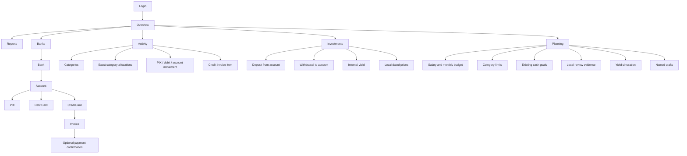

# PRD — Tuxedo Finance

**Status:** Approved baseline, local-finance evolution, assistant foundation and gated authorization preparation

**Current release:** 0.10.0
**Implementation beyond release:** The v1 candidate remains on `feat/personal-finance-evolution`; the assistant continuation is on `feat/tuxedo-assistant-foundation`. Publication and owner validation are separate steps.
**Migration policy:** Preserve released installations through incremental migrations
**Product:** Django personal finance tracker

## 1. Overview

Tuxedo Finance replaces generic payment methods with an explicit banking model. The
release adds banks, currency-specific accounts, an authoritative movement
ledger, PIX, debit and credit cards, card invoices and loyalty points.
Per-user multicurrency preferences and retained historical conversion evidence
are implemented. Investments remain separate while sharing banks and bank
accounts for providers and cash settlement. The authenticated planning workspace
combines a gross-salary monthly plan, existing expense forecasts, optional
private drafts and contribution/yield simulations. Monthly cash
pots and optional account reserves make money available for planning explicit.

The confirmed Unreleased scope adds exact category splits, operational budgets,
goals backed by existing cash, deterministic local review signals, explicitly
reviewed CSV/OFX bank statements, optional manual card payment confirmation,
dated openings, weighted investment cost, local price observations and dated
wealth. It preserves the local installation and default automatic settlement.
No external bank/broker integration or publication is implied by this scope.

The separately confirmed assistant foundation adds private local conversations,
a persistent utility panel/native page and bounded read-only financial context.
The implemented [OpenAI authorization preparation](apps/assistant.md#openai-authorization-preparation)
adds default-disabled account settings, an OAuth lifecycle and an encrypted
credential vault linked to the Django user. It preserves local login and has
independent default-off authorization/inference gates and no financial execution
or paid fallback. The gated catalogue and streaming path is implemented; model
availability still depends on the selected account and explicit model choice.
[Owner-approved native sign-in and local confirmation](reviews/assistant-native-sign-in-2026-10-19.md)
were observed without model listing, inference, financial export or changes to
financial records. Broader deployment/program eligibility and inference remain
unverified; the native observation does not establish Docker real OAuth, model
access/limits, streaming or real refresh/revocation. A later
[bounded streaming validation](reviews/assistant-streaming-2026-10-19.md)
completed a synthetic ChatGPT-plan request without financial context; this does
not establish financial-answer quality, all-model access or live Docker inference.
The broader personal Open Finance study remains research. A separately approved
[Inter bill pilot](open-finance-pilot.md) provides an explicit operator-only read
command with daily private observations; it does not synchronize the ledger or
enable a product connection screen.

The assistant's identity is **Tuxedo, your financial assistant** (**Tuxedo, o seu
assistente financeiro** in Brazilian Portuguese). Versioned
[financial premises](assistant/financial-premises.md) guide personal-finance
explanations, evidence and planning. The current runtime has no Internet
browsing/news tool and does not inherit development-environment plugins.
Future external research needs its own source, privacy, subscription and
validation boundary; instructions alone do not enable it.

The product remains a lean Django full-stack application: native authentication,
SQLite, Django Template Language, TailwindCSS, server-rendered charts and narrow
HTMX progressive enhancement.

### Current delivery status

Requirements below describe approved domain capabilities as well as retained
implementation; they are not all navigation destinations or published features.

| Surface | Current source-checkout status |
|---|---|
| Home/Reports, Transactions/Categories, Accounts, Investments and Plan | Available under the current shared interface contracts. Unreleased changes still need owner acceptance and a separate release decision. |
| Local statement operations (FR34) | Paused: upload, mapping, review, confirmation and undo are gated on GET/POST. Owned confirmed/undone provenance remains read-only. |
| Dated net-worth interface (FR38) | Paused: old screen requests return to Home; calculations and source data remain available to their existing consumers. |
| Assistant foundation (FR39) | Owned local conversations and minimized request context; financial evidence requires a per-request unchecked opt-in. No financial execution endpoint. |
| OpenAI authorization preparation (FR40) | Gated account settings, OAuth lifecycle and encrypted vault; authorization defaults off. Native account linking was observed, without proving inference or wider deployment eligibility. |
| Gated streaming chat (FR41) | Implemented selected-account model catalogue, explicit model choice, SSE/native submission, cancellation and local run history; inference independently defaults off. Live model access/allowance and output quality are not established by code or synthetic tests. |
| Personal Open Finance | Broader PF 6–8-hour aggregation remains research. The separately approved daily Inter bill probe is implemented as an operator-only command; live personal-proxy bill coverage remains unverified. No payment initiation, automatic ledger import or unattended synchronization. |

The [roadmap](roadmap.md) records paused/future work, the
[interface map](interface-map.md) records current screens, and the
[owning app guides](README.md#per-app-reference) define current service behavior.
Checked acceptance items record implemented capability, not automatic release
availability or permission to re-enable a paused workflow.

## 2. Goals

| # | Goal | Expected result |
|---|---|---|
| G1 | Make account balances auditable | Every balance derives from its applicable opening and effective movements. |
| G2 | Model settlement correctly | PIX/debit settle immediately; credit settles through invoices. |
| G3 | Eliminate double counting | Credit spending and invoice payment affect different reporting components. |
| G4 | Multicurrency reporting | Preserve currency-specific account data with per-user reporting and historical FX evidence. |
| G5 | Connect cash and investments safely | Required bank source/destination without merging the ledgers. |
| G6 | Track loyalty value and cost | Editable points entries and complete redemption/IOF details. |
| G7 | Support isolated planning | Estimate CLT take-home pay from gross salary, compare it with the selected month's expenses and optionally save private scenarios without changing financial records. |
| G8 | Support daily personal decisions | Review category limits, explicitly reserved goals and local evidence without inventing money or automatically correcting records. |
| G9 | Import settlement evidence safely | Match or create canonical cash sources only after explicit review, preserving recurring, installment, transfer and invoice semantics. |
| G10 | Explain dated wealth and investment results | Separate weighted cost, local valuation, incurred debt, card credit and incomplete baseline/FX evidence. |

## 3. Scope

### In scope

- Maintain supported released data through incremental migrations; do not infer
  unsupported pre-release data or unknown historical evidence.
- `Bank` with multiple `BankAccount` rows, each in one currency.
- Dated account openings and derived `BankMovement` ledger, retaining unknown
  legacy baselines explicitly.
- PIX enabled as a standard account capability by default.
- Debit and credit cards linked to a bank account.
- Card invoices and default automatic due-date settlement, with optional per-card
  manual confirmation from an explicit due-date boundary and partial payments.
- Ordinary external PIX income/expense and neutral own-account transfers.
- Independent or bank/card-linked loyalty programs and points ledger.
- Currency-specific bank accounts and manual exchange rates.
- Investment products, classified assets, quantity/unit-price operations and
  mandatory bank cash endpoints.
- Monetary investment yields entered directly or derived from a new total
  balance, with a non-persistent preview before saving.
- Dashboard/read models updated for cash, invoices, investments and net worth.
- Authenticated salary planning with a selected-month expense forecast,
  additional fixed expenses, optional named drafts and contribution/yield simulations.
- Distinguish monthly cash pots from investments; exclude positive account funds
  or reserve a fixed native amount for planning while preserving wealth and debts.
- Split a source transaction across compatible owned categories with exact
  installment cent reconciliation, without additional cash or invoice rows.
- Operational monthly category budgets, explicit cash-backed goals and local
  review signals with owner-controlled decisions.
- Local CSV/OFX cash-statement staging, mapping, per-row review, matching,
  confirmation, discrepancy display and guarded undo of unchanged created sources.
- Per-product/asset weighted cost, remaining holdings, realized results, local
  dated prices and disclosed cost fallbacks/unknown baselines.
- Dated wealth including full incurred installment debt and retained card credits,
  without treating forecasts or goal earmarks as new assets.
- Local owner-scoped assistant conversations, signed expiring route context and
  read-only financial snapshots with explicit unavailable-provider behavior.
- Explicitly gated account-model selection and streaming/native responses, with
  cancellation, idempotent local run history and per-request financial context
  opt-in. With either gate off, no external model request occurs.
- Proposed-action/simulation contracts without a daemon or financial execution.
- Default-disabled, owner-scoped ChatGPT account settings, OAuth lifecycle and
  encrypted private vault preparation, with isolated synthetic coverage and
  owner-approved native authorization validation within its dated evidence limits.
- A public-source personal Open Finance feasibility study for Nubank, Banco Inter
  and Mercado Pago, covering 6–8-hour collection and source-preserving reconciliation.
- An operator-only free personal Meu Pluggy Inter bill pilot: explicit offline/live
  modes, hidden one-shot credentials, bounded collection and private daily reuse,
  without database queries, financial writes or enabling paused import routes.

### Out of scope

- Automatic conversion of unsupported pre-release financial rows or invention
  of opening dates, prices, historical fee currencies or returns.
- Automatic Open Finance/bank ledger synchronization, payment initiation, broker/
  issuer APIs and broader cloud financial processing. The explicit read-only
  Inter bill pilot is the scoped exception; research does not enable other integrations.
- Broader deployment/program eligibility guarantees, Docker real OAuth, model
  access/limits or live response-quality guarantees, real refresh/revocation validation,
  action execution, unattended automation and automatic paid-provider fallback
  in this delivery. Live authorization still requires the owner's approval.
- Market-price, FX or loyalty-provider feeds; local prices and rates are manual.
- Tax-lot/tax reporting, automatic investment accrual and annualized,
  time-weighted or money-weighted return inference from incomplete evidence.
- Collaborative accounts, accounting-grade general ledger and tax reporting.
- A SPA, JavaScript charting library or Node/npm runtime dependency. Pinned
  Node-based tooling may compile and verify static assets during development
  and CI; it is not required to run the application.

## 4. Functional Requirements

| # | Requirement | Description |
|---|---|---|
| FR01 | Authentication and isolation | Native Django auth; every financial object and relationship is user-scoped. |
| FR02 | Banks | CRUD for `Bank`, shared by banking, loyalty and investments. |
| FR02A | Base currency | Each user has a base reporting currency, initialized from the project default and independently editable. |
| FR03 | Bank accounts | A bank owns many accounts. Each has name, currency, an opening baseline and PIX capability enabled by default; new nonzero openings require a date. |
| FR04 | Account ledger | Available balance equals the applicable opening plus signed effective `BankMovement` rows. Derived rows are reconciled when their source changes, without rewriting unchanged projections. |
| FR05 | PIX and debit | External PIX and debit-card events create categorized transactions and immediate account movements. |
| FR06 | Cards | Debit and credit cards are linked to one bank account; only credit cards have statement/invoice rules. |
| FR07 | Credit invoices | Credit purchases enter a `CardInvoice` without purchase-date cash debit. Default automatic mode debits once on due date; optional manual mode debits only confirmed actual-date payments. |
| FR08 | No double counting | Spending is recognized from invoice items; invoice settlement changes cash/liability and is not a second expense. |
| FR09 | Own transfers | Transfers between owned accounts create linked debit/credit movements and are never income or expense. |
| FR10 | External PIX | PIX involving an external party is an ordinary `INCOME` or `EXPENSE`, not an own transfer. |
| FR11 | Transactions | CRUD/search/filter for income and expense events, with category, amount, date, recurrence and banking settlement links. The entry form progressively reveals the selected payment channel while retaining server-rendered no-JavaScript controls and validation. |
| FR12 | Categories | Existing category/subcategory management remains for income and expense. |
| FR13 | Loyalty programs | A program may be independent, linked to a bank, linked to cards, or linked to both. |
| FR14 | Loyalty ledger | `LoyaltyEntry` records signed invoice awards, points purchases, adjustments, expirations and redemption debits. Its form reveals invoice fields only for invoice awards and payment fields only for purchases. |
| FR15 | Redemption details | `RewardRedemption` coordinates the points debit, target-account credit and optional IOF. Positive IOF requires an owned bank account or credit card. |
| FR16 | Multicurrency | Each user selects a supported reporting currency in Settings; native amounts and currencies remain unchanged. |
| FR17 | Historical FX | Retain source/target currencies, applied rate, effective date, and conversion status so later rate edits cannot rewrite history. |
| FR18 | Investments structure | Investments remain separate, use `Bank` instead of `Institution`, and group products and assets by bank/product/asset. |
| FR19 | Assets | Every asset has name, code, asset class and currency; class/currency are immutable after use. |
| FR20 | Investment operations | Every `Investment` records a kind and has no title. Unit-valued assets use quantity/unit price; monetary assets use amount. |
| FR21 | Investment cash endpoints | Deposit requires exactly one source bank account or loyalty program; withdrawal requires a destination bank account. Related ledger entries post atomically. |
| FR22 | Internal yield | Yield changes the investment position only and creates no bank income/movement until withdrawn. |
| FR23 | Dashboard | Show account cash, income, expenses, card payable, investment value and net worth using the user's base currency, with historical snapshots and clearly labeled current valuations. |
| FR24 | Forecasts | Recurrences and future invoices may create future-effective derived rows, but these do not alter realized cash before their effective date. |
| FR25 | Release compatibility | Preserve existing released data through incremental migrations; the historical pre-release reset is not a normal update procedure. |
| FR26 | Interface language | English and Brazilian Portuguese are selectable without localized URL prefixes; the selection persists in Django's language cookie and is independent of currency. |
| FR27 | Clean account bootstrap | A newly created account receives only the approved top-level categories. Optional synthetic financial data requires the explicit `insert_demo` command and a new, separate account; no demo database, shared account or fixed credential is shipped. |
| FR28 | Local database ownership | The repository does not track `db.sqlite3`; migrations create each installation's database, whose owner is responsible for protection and backup. |
| FR29 | Planning sandbox | Estimate CLT net salary from gross input, compare the selected month's expense forecast, add missing BRL/percentage expenses and optionally save a named draft. Simulations never post financial movements. |
| FR30 | Exact category splits | Allocate a source across distinct compatible owned categories whose positive amounts sum exactly; installments reconcile cents per month and across the full plan without new sources or cash rows. |
| FR31 | Operational budgets | Persist positive monthly category/currency limits, including descendants without overlapping branches; compare recorded and known forecast spending and retain missing-FX status. |
| FR32 | Backed goals | Reserve existing account or monetary monthly-cash balances explicitly, prevent active over-allocation, show later backing shortfalls and release availability on archive without adding an asset or movement. |
| FR33 | Local review signals | Explain bounded duplicate/subscription, budget and projected-cash evidence, with configurable thresholds and acknowledge/dismiss decisions; never automatically alter records. |
| FR34 | Local statement import | Stage bounded CSV/OFX, map explicitly, review every row, match/create/pay/transfer through owned canonical services, verify confirmation digest and external identities, display discrepancies and guard undo after changes. |
| FR35 | Manual invoice payments | Preserve automatic mode by default; opt in from a due-date boundary, retain sticky manual invoices and post positive same-currency actual-date confirmations idempotently. Source corrections preserve real payments and credits. |
| FR36 | Dated openings | Require dates for new nonzero account/asset openings, include known openings only from their date and disclose migrated unknown baselines without inventing history. |
| FR37 | Investment results | Replay weighted cost per product/asset after valid edits/deletion, preserve yield entry values and actual cash, and apply only explicitly declared asset-currency fees. Local quotes expose valuation and missing-price cost fallbacks. |
| FR38 | Dated wealth | Compose dated cash and position valuation, incurred card debt including future installments, and card credits; exclude future recurring occurrences, duplicated settlements and goal earmarks. |
| FR39 | Local assistant foundation | Persist owned conversations; minimize signed route context by default and collect bounded financial evidence only through explicit per-request opt-in, preserving cutoff/native currency/warnings without financial writes. |
| FR40 | Gated account authorization preparation | Prepare owner/session-bound ChatGPT linking, account selection and encrypted credentials; authorization defaults off and requires owner approval, independently of inference. |
| FR41 | Gated selected-model chat | Require both gates, an eligible owned selected connection and explicit catalogue model choice; support text streaming, cancellation, bounded native fallback and idempotent local run/partial-history states, without tools or automatic paid fallback. |

## 5. Domain Rules

### Current implementation status

Tuxedo Finance currently supports editable personal records. Each user has a
`accounts.UserPreference` row with a base reporting currency. New and existing
users default to BRL; changing the preference affects consolidated display only
and does not mutate native financial records. Cross-currency transfers and
investment operations persist an FX snapshot, while read-time manual rates
serve explicitly labeled current or selected-date valuations elsewhere.

### 5.1 Balance and settlement

- Amounts are positive; direction/kind carries the sign.
- Account balance is never calculated from transaction totals.
- PIX, debit card and direct account events settle immediately.
- Credit purchases affect expense reporting and card payable, not available cash.
- Automatic invoice settlement creates one due-date account debit. Manual
  confirmation creates one actual-date debit per explicit payment and can be
  partial. Neither creates expense again; paid status is not proof of external
  confirmation in automatic mode.
- Manual confirmation UUIDs prevent duplicate cash posting. Purchase corrections
  retain confirmed payment evidence, including excess card credit.
- Dated debt includes the whole incurred installment purchase; future fixed
  recurrence occurrences remain forecasts rather than debt.
- Personal financial rows remain editable and deletable by their owner.

### 5.2 Transfer classification

- Source and destination both owned by the user means own transfer.
- An own transfer has two linked movements, is category-neutral and is excluded
  from income/expense and consolidated net cash flow.
- Different currencies retain source and destination amounts plus the applied
  FX snapshot when conversion is available. Missing conversion remains an
  explicit incomplete status.
- PIX alone does not imply transfer. An external PIX is normal income/expense.

### 5.3 Loyalty

- Points balance is the signed sum of `LoyaltyEntry` rows.
- Invoice awards may reference the eligible invoice.
- Purchases, adjustments, expirations and redemption debits remain
  distinguishable in the points ledger.
- `RewardRedemption` carries the points, target amount/account and IOF details,
  then links the generated points debit and bank movements. Account-funded IOF
  settles immediately; credit-card IOF follows the card-invoice flow.

### 5.4 Currency

- `UserPreference.base_currency` selects each user's reporting currency.
- The preference is created automatically at signup and backfilled safely for
  existing users with the code-level BRL default.
- Switching currency recalculates presentation totals only; native amounts are
  never converted or relabeled.
- Cross-currency transfers and investment operations persist source/target
  currencies, rate value, effective date, and status. Existing rows are
  reconstructed only when an authoritative rate provides evidence; otherwise
  native values remain intact and conversion is marked incomplete. Editing an
  event's amount, currency, or date refreshes its snapshot; descriptive edits do
  not. Other entities use labeled read-time conversion at their selected cutoff,
  rather than captured operation snapshots.

### 5.5 Investments

- The investment position ledger and categorized transaction ledger stay
  separate.
- `Bank` replaces `Institution` as investment product provider.
- Unit-valued assets store quantity and unit price; monetary assets store amount.
  The `Investment` operation has no title.
- Deposit/withdrawal cash movements are not income/expense.
- A deposit has exactly one account or loyalty-program source; a withdrawal has
  one destination account.
- Yield is internal and creates no account movement.
- Replay is ordered by date, registration time and primary key. Weighted cost is
  independent per product/asset; edits/deletion cannot leave any later position
  negative. A full disposal clears quantity and remaining cost.
- Unit yields preserve their declared entry value. Fees affect cost/results only
  with an explicit asset-currency declaration, default unchecked; legacy fees
  remain metadata and no cost calculation reinterprets recorded cash.
- Local dated quotes choose the latest price by the cutoff. Missing quotes use
  a disclosed remaining-cost fallback, not an invented market value or return.
- New nonzero openings require dates; older unknown dates remain incomplete
  evidence. Recorded results do not establish tax-lot or annualized returns.

### 5.6 Public registration

- A single `ALLOW_SIGNUPS` environment setting controls whether the public
  signup route may create new native Django users; it defaults to `True` for an
  open local/community instance.
- When disabled, direct requests return a localized explanation and persist no
  user. Login and all existing accounts remain unchanged.
- Public navigation reflects the same setting, but authorization is enforced in
  the server-side signup view rather than by link visibility alone.

### 5.7 Planning sandbox

- Salary planning derives ordinary monthly CLT net pay from the entered gross
  salary and payroll parameters, then deducts the selected month's existing
  expense forecast and additional BRL or gross-salary-percentage expenses. The
  explicit rule-year limitation is documented in the [sandbox guide](apps/sandbox.md).
  Missing inputs are
  not interpreted as zero or a valid completed plan.
- Scenarios are saved only through an explicit action, never by autosave or a
  background request. They do not create or modify financial ledger entries.
- New month forecasts use the economic reference month, including card
  installments and recurrences; invoice settlement is not another expense.
  Saved legacy drafts retain their captured payment-month basis until explicit
  recalculation. Opening or comparing a draft does not silently rewrite it.
- Monthly contribution/yield simulations accept editable amounts and rates and
  display their assumptions. External price/history feeds and execution of
  model-proposed simulations remain outside the implemented local scope.

### 5.8 Operational limits, goals and signals

- Budgets use categorized economic reference months, including exact splits;
  they do not create cash reservations or payments.
- Goal progress uses explicitly reserved positive existing account or monetary
  cash-pot backing. Active claims cannot exceed backing at save; later shortages
  remain visible. Manual and named account reserves overlap by their maximum,
  not their sum. Reservations do not reduce net worth.
- Archived goals release planning availability and retain protected denomination
  references. Restoring checks backing again.
- Signals use bounded local evidence and explicit decisions. Planned unpaid
  manual invoices affect cash-shortage forecasts once, without synthetic debits.
- Historical goal progress uses current saved definitions, not an immutable
  snapshot of previous target/reservation edits.

### 5.9 Local statement confirmation

- Upload/mapping/review post nothing. Every entry requires an explicit action.
- Exact existing-movement matching posts no second transaction. A bank payment
  of a card invoice is settlement, not a new consumer expense; existing
  recurrence, installment, transfer and investment sources are retained.
- Confirmation revalidates ownership, account currency, dates, categories,
  reviewed digest and unique bank identifiers atomically. No nonzero unknown
  account baseline is inferred from a file.
- Closing discrepancies remain evidence; they do not create a balancing entry.
- Undo removes only unchanged sources created by that batch and refuses changed
  or subsequently matched evidence. Matched originals and review history remain.

### 5.10 Assistant and external-integration boundaries

- Django authentication and current record ownership remain authoritative.
  Conversation UUIDs, client route values and model text do not grant access.
- Structured context is server-built from a signed, expiring owner-bound
  allowlist scope. It never scrapes unsent forms or synchronizes financial rows.
- With either provider gate off, message submission fails without a fake saved
  exchange or external model call. Eligible explicit submissions retain their
  local user input, terminal run state and bounded completed/partial output.
  Local history remains until explicit deletion and is covered
  by the installation's ordinary database/backup responsibilities.
- Proposed actions and simulations are not execution. Later financial writes
  require canonical services, fresh ownership/state checks and the applicable
  explicitly enabled bounded rule or review decision. No such execution exists now.
- The [prepared ChatGPT authorization lifecycle](apps/assistant.md#openai-authorization-preparation)
  links accounts to the Django user, keeps credentials in the private encrypted
  vault and requires the original session's final confirmation. Default-disabled
  real authorization and model use remain separate gates; no API-key
  billing fallback is inferred. The [native observation](reviews/assistant-native-sign-in-2026-10-19.md)
  covered an owner-approved account link using process-only opt-in, with `.env`
  unchanged and no model request or financial export. It does not establish
  other deployments, model access/limits, streaming or real refresh/revocation.
- The [Open Finance study](reviews/open-finance-personal-study-2026-10-18.md)
  excludes payment initiation and does not reopen paused statement operations.
- The [bill pilot](open-finance-pilot.md) keeps credentials in one command's memory
  and observations in private operator files. Proxy provenance remains human-
  attested, missing values stay unknown, and reported payments do not establish
  local paid status. Bank consent and live coverage are not established by mocks.

## 6. Data Structure

The canonical entity-relationship diagram and posting-flow diagram are in
[data-model.md](data-model.md). That document uses the implemented Django model
names and is the normative reference for fields, relationships, constraints and
formulas.

## 7. App Organization

```text
core/          # configuration, currency and formatting
pages/         # public site
accounts/      # authentication
categories/    # category hierarchy
banking/       # banks, accounts, ledger, PIX, cards, invoices, loyalty, FX
transactions/  # economic events and recurrence
dashboard/     # read models and reports
investments/   # products, assets, position operations and valuation
planning/      # operational budgets, cash-backed goals and local review signals
ingestion/     # explicitly reviewed local cash statements and guarded undo
sandbox/       # private planning drafts and isolated simulations
assistant/     # local conversations, minimized context, gated authorization and streaming
```

Navigation and financial relationships use the current banking concepts.

## 8. UX Flows



Banking setup leads with bank and account creation. PIX requires no separate
payment-method record because it is an account capability. Transaction forms
show only instruments compatible with the selected account/currency and owned by
the logged-in user.

This navigation diagram intentionally omits paused statement and net-worth
interfaces; their retained domain requirements do not restore application links.

## 9. Dashboard and Reports

The dashboard separates cash, economic activity, liabilities and positions:

| Component | Source |
|---|---|
| Bank cash | Applicable dated openings + effective bank movements. |
| Planning availability | Bank cash + remunerated cash - overlapping manual/named reserves and exclusions; deficits stay included. |
| Income/expense | Categorized transactions; no transfers/investment cash legs. |
| Card payable | Billed invoice remainder; dated wealth uses full incurred purchases/installments and realized recurrences less effective settlements. |
| Investment value | Replayed holdings × latest local dated unit quote, or disclosed remaining-cost fallback; monetary positions use balance and historical cost retains operation FX. |
| Net worth | Converted bank cash + all product/cash-pot values + card credit - positive incurred card debt; no new asset from reserves. |

Reports remain responsive, server-rendered SVG/CSS. HTMX may swap chart islands
and progressively enhance same-origin links, but all filters and navigation
retain plain GET fallbacks. Every total states its
currency/valuation date and whether it is actual or projected.

The Reports summary keeps live bank cash, the identified anchor month's inflows
minus outflows, and net bank-balance change over the complete displayed window.
Monthly result includes recorded investment deposits and withdrawals without
adding the opening balance. A keyboard-accessible question-mark disclosure
explains the full-window dates and incomplete totals when exchange rates are
missing. Do not show the former best-month summary card.

The retained, currently gated dated wealth view uses month-end cutoffs, capped at today, with a
start-month GET filter limited to the last ten years. Unknown baselines and
missing FX/prices are explicit limitations. It is reconstructed editable
financial history, not an immutable bank statement or return percentage.

## 10. Frontend Requirements

- Use the approved [visual catalogue](design-system.html) and
  [route/component map](interface-map.md). Shared editorial components retain
  Inter typography, the cream/forest light palette, neutral black/graphite dark
  foundations, accessible semantic colors and mobile-first behavior. Ordinary
  text maintains WCAG AA contrast; user-facing labels do not render below 12px,
  except for the approved [mobile navigation labels](frontend/navigation.md#root-layout-and-navigation)
  at 10–11px, never below 10px, with touch targets of at least 44 × 44px.
- The same five workspace destinations appear in desktop and mobile navigation.
  Secondary work stays in its owning section; paused resources are not links or
  disabled promotional entries. Native navigation remains available.
- Forms, help, filters, menus, dates, period controls and departure/history
  handling follow the [canonical frontend contracts](frontend.md). Reuse shared
  partials and enhancements, preserve keyboard/focus/error recovery and complete
  native fallbacks, and keep ownership/accounting validation on the server.
- Explain cash versus economic activity where the user makes the choice:
  credit purchases belong to invoices, while account/PIX/debit settle directly.
  Own transfers retain a neutral treatment. Totals identify their currency,
  valuation cutoff, actual/projected scope and missing evidence with text.
- Interface labels and system messages have English and Brazilian Portuguese
  translations. Django's language cookie is independent of the reporting
  currency and preferred date order. Stored user data remains verbatim; default
  categories are translated once when the account is created.
- The [contribution guide](../CONTRIBUTING.md) owns build, translation and isolated
  validation commands. Changed financial interactions need focused regression
  evidence, including native forms, keyboard use, both themes and phone layouts;
  historical test counts are not current acceptance evidence.

## 11. Non-Functional Requirements

| # | Requirement | Description |
|---|---|---|
| NFR01 | Atomicity | Multi-row posting workflows run in one database transaction. |
| NFR02 | Idempotency | Source-key projection, confirmation UUIDs and reviewed import identities cannot duplicate settlement movements. |
| NFR03 | Editability | Personal records may be corrected by their owner; audit-grade reversals are out of scope. |
| NFR04 | Isolation | Querysets, forms and services validate user ownership. |
| NFR05 | Precision | Decimal arithmetic only; explicit currency and rounding policy. |
| NFR06 | Performance | Use scoped related-object loading, bounded folds and owned request-scoped FX reuse; compare projections before writing and retain unchanged IDs/timestamps. SQLite atomic writes remain serialized. |
| NFR07 | Accessibility | Responsive keyboard-usable server-rendered UI and text status labels. |
| NFR08 | Simplicity | Native Django patterns; no SPA or external general-purpose API. The narrow authenticated assistant context endpoint remains internal and read-only. |
| NFR09 | Assistant boundary | Local history and signed context remain owner-scoped; no provider, external inference, execution or paid fallback is silently enabled. |

## 12. Acceptance Criteria

Checked items describe implemented behavior in the current code, not a claim
that every feature shipped in `0.10.0`. The Unreleased branch still requires
the owner's manual acceptance before a separate merge/release decision.

- [x] One bank can hold multiple accounts with independent currencies/opening balances.
- [x] Account balance exactly reconciles to its applicable opening and effective movements.
- [x] PIX capability defaults on; an external PIX posts normal income/expense immediately.
- [x] Debit posts immediately; credit purchase enters an invoice without cash debit.
- [x] Default invoice due-date settlement debits the account once and does not duplicate expense.
- [x] Own transfers create paired movements and never affect income/expense.
- [x] Captured historical operation-flow totals remain unchanged after a newer
      FX rate is added; local-price and read-time valuations state their cutoff.
- [x] Loyalty supports all five entry kinds and complete redemption/IOF funding data.
- [x] Investments use `Bank`, classified/currency assets and quantity/unit price, with no title.
- [x] Investment deposit source and withdrawal destination are required; yield is internal.
- [x] Dashboard reconciles cash, card payable, investments and net worth without double count.
- [x] Mobile and desktop banking/investment flows preserve no-JS fallbacks.
- [x] English and Brazilian Portuguese work on full pages and HTMX fragments,
      retain stable URLs, and do not alter currency separators or user data.
- [x] Fresh migrations install successfully on an empty SQLite database.
- [x] The root SQLite database is ignored by Git and a clean clone becomes usable after migrations.
- [x] Unsupported pre-release legacy schemas are distinguished from supported release upgrades.
- [x] Monetary yields can derive the stored yield from a new total balance without creating a bank movement.
- [x] The authenticated planning workspace supports salary estimates, explicit private drafts and isolated simulations.

### Unreleased implementation

- [x] Optional manual invoices preserve automatic behavior before the selected
      boundary, confirm partial actual-date payments once and retain card credit
      after source corrections.
- [x] Exact category splits reconcile every installment and the original totals,
      retain reporting/export allocations and leave cash settlement unchanged.
- [x] Category limits and named goal reservations are persisted separately from
      sandbox scenarios, with backing/ownership/denomination validation.
- [x] Local signals provide evidence, configurable thresholds and explicit
      decisions without automatic financial corrections.
- [x] Local statement mapping/review/confirmation/undo preserves canonical
      source semantics and rejects stale, duplicated or incompatible evidence.
- [x] New nonzero openings require dates; unknown migrated baselines remain
      visible without invented acquisition or cash history.
- [x] Weighted investment cost, local prices, realized/remaining results and
      incomplete-performance warnings preserve declared yields and legacy fees.
- [x] Dated wealth includes incurred installment debt and card credits once,
      while reservations and future recurring templates create no new asset/debt.
- [x] Unchanged ledger synchronization avoids repeated unchanged writes;
      request-scoped FX reuse preserves missing/captured evidence boundaries.
- [x] Owner-scoped assistant account settings, OAuth lifecycle and encrypted
      vault preparation keep real authorization disabled by default; isolated
      synthetic validation does not silently enable inference.
- [ ] Owner completes the branch's manual acceptance walkthrough on isolated
      synthetic data and then explicitly approves any merge or publication.

## 13. Release validation

Each release retains committed migrations and preserves existing financial
records. Validate fresh installation, upgrade from the supported previous
release, owner isolation, reconciliation, and backup/restore on disposable data.
New financial behavior requires focused tests and bilingual, keyboard-accessible
interfaces. Run the checks in `CONTRIBUTING.md` before release.

## 14. Historical pre-release reset

The original banking redesign intentionally replaced an unsupported pre-release
schema. That completed delivery had no automatic legacy-data conversion. It is
historical context, not a standing requirement to regenerate initial migrations
or create an empty database. Published installations, including v0.3.0 Docker
volumes, retain their records through incremental migrations. Recovery uses the
matching application image and database backup; reverting an image alone does
not undo schema changes.

## 15. Docker installation (v0.3.0, issue #18)

Provide a single-instance Docker/Compose installation with a persistent SQLite
volume and signing key, a non-root Gunicorn runtime, and static assets with
`DEBUG=False`. Preserve native Python/uv installation and existing financial
semantics. Default network access remains local to the Docker host.

The delivery includes build-from-source support, isolated lifecycle/browser
checks, bilingual quick starts and backup/restore/update instructions. Release
images must pass native amd64 and arm64 tests before publication. The no-clone
installation is complete only after a release supplies configuration assets and
an anonymously pullable versioned GHCR image. This does not introduce SaaS,
replicas, a different database, automatic updates or legacy-schema conversion.
